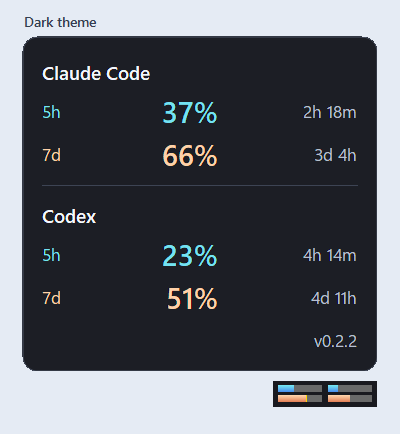

# AgentMeter Taskbar

AgentMeter Taskbar shows 5-hour and weekly usage limits for Claude Code, Claude Desktop, and Codex on the Windows 11 taskbar. Hover over the bars to see usage percentages, reset times when available, and the installed version.

Requires Windows 11 x64 and a classic taskbar with DeskBand toolbar support. StartAllBack with the classic taskbar enabled is one example.

**[Download for Windows 11][latest-release]**

| Quotas on hover | Usage increase |
| --- | --- |
|  |  |

Captured from the running toolbar with sample usage.

## Install

1. Download `AgentMeter-Taskbar-Setup-v*.exe` from the [latest release][latest-release].
2. Open Setup and click **Install**. It installs for your Windows account. Windows may show **Unknown publisher** on first launch. When you finish Setup, Windows Explorer restarts to load AgentMeter.
3. Right-click the taskbar and choose **Toolbars → AgentMeter Quotas**. If it is missing from the menu, sign out of Windows and sign back in.

## Show your limits

- **Claude Code**. Setup connects an existing Claude Code profile automatically. Limits appear after Claude Code answers your first request. Setup preserves any custom status line. If you use one, Claude Desktop can supply your limits.
- **Claude Desktop**. Open the app. If the percentages are still missing, open **Settings → Usage** in Claude Desktop.
- **Codex**. Limits appear automatically once a local Codex session reports them.

Allow up to one minute for the taskbar to refresh.

## Read the bars

- **Horizontal taskbar**. Each service has two stacked bars with five-hour usage above weekly usage.
- **Vertical taskbar**. From left to right, the bars are Claude 5h, Claude 7d, Codex 5h, and Codex 7d.
- **Hover over the bars** to see percentages, reset times when available, and the installed version. If both limits for a service increase, the animation shows the weekly increase.

An empty bar can mean 0% usage or missing data. The popup shows which applies. AgentMeter keeps the last known Claude percentages across restarts. A dimmed fill and a **Last known** note with the observation time mark an older value. A Claude reading with no reset time counts as current for 15 minutes.

## Update or uninstall

AgentMeter checks for updates at sign-in and once a day. Select **Check for updates** in the popup to see the result there. If a new version is available, select **Update** to install it and restart Windows Explorer. Background updates take effect the next time Windows Explorer starts.

To uninstall, open **Settings → Apps → Installed apps → AgentMeter Taskbar**. Setup removes the Claude Code entry it added. If the toolbar is still visible after uninstalling, restart Windows Explorer.

[MIT License](LICENSE)

[latest-release]: https://github.com/rrokot/AgentMeter-Taskbar/releases/latest
