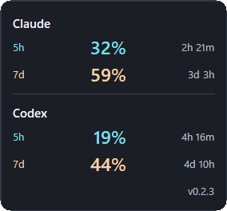

# AgentMeter Taskbar

Панель задач Windows с лимитами Claude и Codex. У каждого сервиса видны две полосы для пятичасового и недельного периода. При наведении появляются проценты, версия панели и время до сброса, если оно известно.

На горизонтальной панели у каждого сервиса две строки. Сверху показан пятичасовой лимит, снизу недельный. На вертикальной панели четыре полосы стоят рядом.

[English documentation](../README.md)

| Лимиты при наведении | Анимация прироста |
| --- | --- |
|  |  |

Снято с работающей панели на демонстрационных данных.

## Установка

Нужны Windows 11 x64 и StartAllBack с включённой классической панелью задач.

1. Скачай `AgentMeter-Taskbar-Setup-v*.exe` из [GitHub Releases](https://github.com/rrokot/AgentMeter-Taskbar/releases/latest).
2. Запусти мастер установки. Windows может показать **«Неизвестный издатель»** при первом запуске. Мастер также обновляет прежнюю установку из ZIP.
3. Щёлкни правой кнопкой по панели задач и выбери **Панели инструментов → AgentMeter Quotas**. Если пункта пока нет, выйди из Windows и войди снова.

Codex появится, когда локальный сеанс Codex CLI запишет свои лимиты. Сборщик ищет свежую запись в `CODEX_HOME` или `%USERPROFILE%\.codex`.

Сборщик обновляет панель раз в минуту. Проценты Claude Desktop считаются свежими 15 минут. AgentMeter хранит последние известные проценты для каждого периода и показывает их после перезагрузки. Устаревшая полоса приглушена, а в подсказке указаны **Last known** и время замера. Если проценты ещё не появились, открой **Settings → Usage** в Claude Desktop.

### Настройка Claude Code

Claude Code передаёт доступные лимиты для поддерживаемых подписок через [команду строки состояния](https://code.claude.com/docs/en/statusline#rate-limit-usage). Данные появляются после первого ответа в сеансе.

В мастере можно выбрать **Connect Claude Code**. Он подключит AgentMeter, если отдельная строка состояния ещё не настроена. Для подключения из собственного скрипта подойдёт ручная настройка ниже.

Выполни команду в Windows PowerShell, чтобы получить настройку с путём к установленному скрипту:

```powershell
$scriptPath = (Join-Path $env:LOCALAPPDATA 'AgentMeterTaskbar\ClaudeStatusLine.ps1').Replace('\', '/')
$command = 'powershell.exe -NoProfile -NonInteractive -ExecutionPolicy Bypass -File "' + $scriptPath + '"'
@{ statusLine = @{ type = 'command'; command = $command } } | ConvertTo-Json -Depth 3
```

Добавь поле `statusLine` в `%USERPROFILE%\.claude\settings.json` или в файл настроек в `CLAUDE_CONFIG_DIR`. Сохрани остальные настройки. Если строка состояния уже настроена, можно передавать тот же JSON в скрипт AgentMeter с флагом `-Quiet` из своей команды.

Выполни один запрос в Claude Code. Панель обновит данные в течение минуты. Значение считается свежим до времени сброса или в течение 15 минут, если время сброса неизвестно.

## Обновление и удаление

Автообновления включены по умолчанию. AgentMeter проверяет GitHub при входе в Windows и раз в сутки, сверяет подпись релиза и контрольную сумму установщика, затем устанавливает новую версию в фоне. Новая DLL загрузится при следующем запуске Проводника. Для ручной проверки открой **Пуск → AgentMeter Taskbar → Check for updates**. Настройку автообновлений можно изменить повторным запуском мастера.

Для удаления открой **Параметры → Приложения → Установленные приложения → AgentMeter Taskbar**. Мастер удалит настройку Claude Code, которую добавил сам. Если подключал AgentMeter из собственного скрипта, убери из него вызов AgentMeter. Проводник освободит загруженную DLL после завершения процесса.

Тесты запускаются в Windows PowerShell 5.1 с Pester 3.4. Данные тестов локальны.

```powershell
powershell.exe -NoProfile -Command "Invoke-Pester .\tests -EnableExit"
```

AgentMeter Taskbar распространяется под [лицензией MIT](../LICENSE). Уведомление о лицензии исходного AgentMeter включено в [NOTICE-AgentMeter.txt](../NOTICE-AgentMeter.txt).
